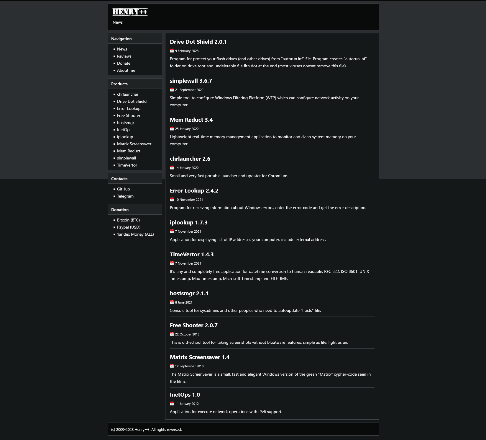

<h1 align="center">henrypp.org</h1>

	
	
	
	
	

	

### Description:

Website source code with CMS engine.

### Donate:
- [Bitcoin](https://www.blockchain.com/btc/address/1LrRTXPsvHcQWCNZotA9RcwjsGcRghG96c) (BTC)
- [Ethereum](https://www.blockchain.com/explorer/addresses/eth/0xe2C84A62eb2a4EF154b19bec0c1c106734B95960) (ETH)
- [Yandex Money](https://yoomoney.ru/to/4100115776040583) (RUB)
- [Paypal](https://paypal.me/henrypp) (USD)

---
- Website: [github.com/henrypp](https://github.com/henrypp)
- Support: sforce5@mail.ru
---
(c) 2012-2027 Henry++
